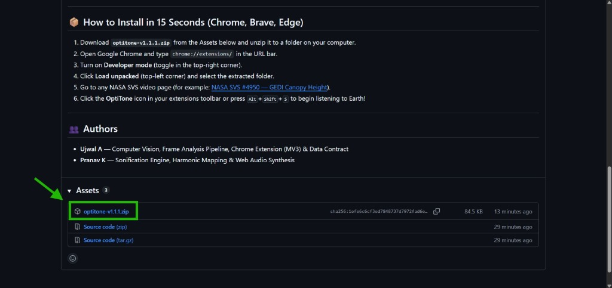
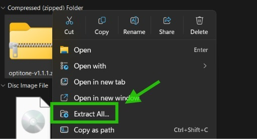

# OptiTone

OptiTone is an intelligent scientific sonification browser EXTENSION that converts NASA Earth science visualisations, videos and datasets into meaningful, synchronised audio experiences!

## How it works

So... our system uses a browser extension and a standalone Demo Studio to analyse supported scientific sources. It extracts information such as intensity, colour, spatial distribution, motion and temporal changes, organising it into a Scientific Feature Representation (SFR) that preserves scientific context, uncertainty and data provenance. Its semantic mapping engine then translates these features into sound, with an auditory legend explaining what listeners hear.

## How to Download and Install OptiTone

Follow this step by step guide to download and install the OptiTone extension in Google Chrome.

### Step 1: Open GitHub Releases

Look at the Releases option on the right side of the GitHub repository page as highlighted by the green box and arrow.

### Step 2: Download the Release Archive

Under the Assets section of the latest release, click on the optitone zip file to download the compressed extension package directly to your computer.

### Step 3: Extract the Downloaded Folder

Locate the downloaded zip file in your file explorer, right click on it, and select the Extract All option to uncompress all files into a regular folder.

### Step 4: Open Chrome Extensions and Enable Developer Mode

Visit the site chrome://extensions in the Google Chrome address bar and turn on Developer mode using the switch in the top right corner.

### Step 5: Click Load Unpacked

Click the Load unpacked button located in the top left corner of the extensions management page.

### Step 6: Select the Extracted Folder

From the folder picker dialog that appears, select the unzipped optitone folder that contains the unpacked extension files.

### Step 7: Verify Installation

OptiTone will now appear in your My extensions section, fully installed and ready to use.

## How to Use OptiTone

After downloading and installing the extension, follow these steps to experience live sonification.

### Step 8: View OptiTone in the Browser Toolbar

Click the extensions icon on your browser toolbar to see OptiTone pinned with confirmed site access on supported video pages.

### Step 9: Open the Extension Popup Toggle

Clicking the OptiTone icon opens a clean control popup containing an on and off toggle switch currently in its off position.

### Step 10: Turn On Sonification

Clicking the toggle switch turns it on with a glowing green indicator, enabling live synchronised sound generation for the playing scientific video.

## Project File Structure

Below is the directory structure of the repository:

* docs/
  * CONTRACT.md: Specification for the standardized ejb:frame v1 scientific event contract.
  * METHODOLOGY.md: Complete scientific documentation, mathematical models, color calibration, and data provenance.
  * PRIVACY.md: Privacy policy confirming local client side execution with zero data collection.
  * images/: Step by step visual screenshots for downloading, installing, and using OptiTone.
* extension/
  * manifest.json: Chrome Manifest V3 configuration defining content scripts, background worker, and permissions.
  * vite.config.ts: Build configuration for bundling extension components.
  * public/: Static icons and favicon assets in multiple resolutions.
  * src/
    * analysis/: Computer vision algorithms including color, luminance, motion delta, normalization, and regional spatial grid calculations.
    * audio/: Web Audio API synthesis engine, pitch scales, temporal smoothing, spatial panning, and sound profiles.
    * audio/synths/: Specialized synthesizer voice modules including base lead voice, noise voice, pulse voice, and percussion transients.
    * background/: Service worker handling lifecycle events and extension management.
    * content/: Media finder, video frame capture pipeline, and event emitters running inside the web page context.
    * contract/: TypeScript definitions and data contract schemas.
    * offscreen/: Offscreen document facilitating background audio context management.
    * popup/: Browser action popup interface with user controls and live metrics display.
    * presets/: Calibrated configuration profiles for NASA Earth Information Center and Scientific Visualization Studio datasets.
* scripts/
  * build-extension.js: Automated build script producing unpacked extension bundles.
  * generate-icons.js: Utility generating multi size icon assets.
  * package.js: Distribution script packaging release archives for GitHub.
* test/: Comprehensive Vitest test suites verifying audio engine synthesis, color detection, motion tracking, contracts, and spatial algorithms.
* mock-emitter.ts: Synthetic data emitter for automated end to end testing.
* package.json: Project configuration, scripts, and runtime dependencies.
* tsconfig.json: TypeScript compiler options and build targets.
* vitest.config.ts: Unit and integration testing configuration.
* LICENSE: MIT open source license.

## Technology Stack

OptiTone is built using the following technologies:

* TypeScript: Static typing across all visual analysis pipelines, audio nodes, and event contracts.
* JavaScript: High performance ES modules executing inside content scripts, background workers, and audio processors.
* React: Component based architecture for interactive user interfaces and dashboard inspectors.
* Vite: Fast frontend tooling and bundler powering extension builds and development workflows.
* Chrome Manifest V3: Modern extension platform utilizing content scripts, service workers, and offscreen canvas documents.
* Web Audio API: Browser native audio synthesis graph featuring oscillators, gain nodes, biquad filters, stereo panners, and dynamics compressors.
* Tone.js: Advanced polyphonic synthesis scheduling, melodic pitch quantization, and musical timing foundations.
* Web Workers: Off thread computational analysis preventing user interface stutter during high frequency frame processing.
* Vitest: Unit and integration test runner validating mathematical algorithms and audio parameter ranges.
* Git and GitHub: Distributed version control, release management, and issue tracking.

## Key innovations

* Scientific Feature Representation: Supports different data types, including scalar values, spatial grids, events, vectors and time series.
* Scientific integrity: Distinguishes actual measurements, published metadata, calibrated visual estimates and visual proxies.
* Semantic mapping: Selects sounds based on the meaning and relationships of scientific features rather than arbitrary frequency assignments.
* Indian musical composition: Our extended direction introduces ragas, talas, melodic structures and suitable instruments to generate original compositions influenced by scientific data.
* Unique musical identities: Different datasets can produce distinct compositions based on their scientific characteristics, with music evolving as the underlying data changes.
* Synchronised audio: Sound responds to changes and significant events in the visualisation.

## Benefits and intended impact

OptiTone improves accessibility to complex scientific information, supports auditory learning and makes NASA's Earth science discoveries more engaging. It aims to help users understand patterns and changes through sound, including those that may be difficult to identify visually.

## Development Considerations

We considered scientific accuracy, data provenance, uncertainty, accessibility, audio quality, synchronisation, browser security and cross origin restrictions. We also prioritised performance on standard hardware, fallback demonstrations when live capture is unavailable, and the use of original, appropriately licensed musical content.
