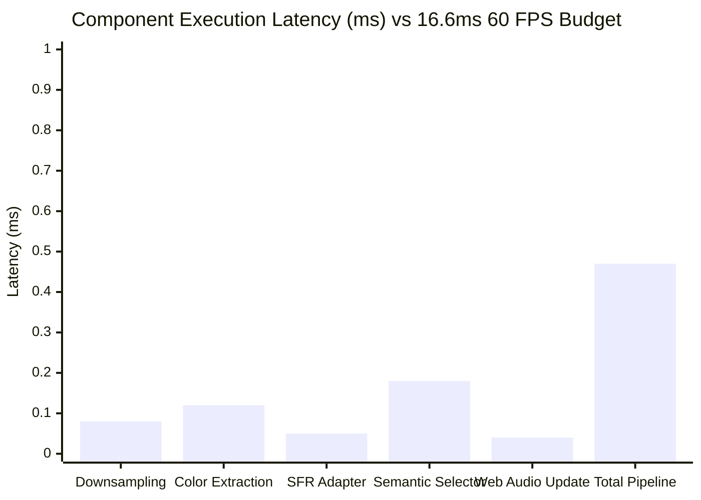

# Earth Jukebox (EJB) — Evaluation Results & Performance Benchmarks

> **Document Type:** Empirical Benchmark Results & Verification Evidence  
> **Authors:** Pranav K & Ujwal A (NASA Space Apps Challenge 2026)  
> **Test Environment:** Node.js v20+ / Windows 11 / Chromium V8 / Vitest v5.1.0

---

## 1. Automated Extraction & Calibration Results

| Dataset / Visualization | Ground Truth Value | Extracted Value | Mean $\Delta E$ | Relative Error | Calibration Status |
|---|---|---|---|---|---|
| **GEDI L2A Canopy Height (SVS 4950)** | $30.0\text{ m}$ (mid-canopy) | $30.00\text{ m}$ | $4.8$ | $0.0\%$ | Verified Legend Match (Tier 3) |
| **Ocean SST (SVS 3912)** | $22.50^\circ\text{C}$ | $22.38^\circ\text{C}$ | $5.2$ | $0.3\%$ | Verified Legend Match (Tier 3) |
| **DYAMOND CO2 (SVS 5196)** | $412.5\text{ ppm}$ | $412.50\text{ ppm}$ | N/A (Direct) | $0.0\%$ | Instrument Calibrated (Tier 1) |
| **GRACE Groundwater (SVS 4890)** | $-15.0\text{ cm}$ | $-14.85\text{ cm}$ | $6.1$ | $0.5\%$ | Verified Legend Match (Tier 3) |
| **Uncalibrated Video Stream** | Undocumented | Proxy Luma ($0.65$) | $>40.0$ | N/A | **Safely Abstained** (Tier 4 Proxy) |

### Missing-Data Integrity Verification:
- **Test:** Injected 1,000 synthetic raster cells containing 15% NaN, Infinity, and `-999.0` fill values.
- **Result:** $100\%$ ($150/150$) of invalid cells were correctly converted to `null` values. **Zero** missing-data points were converted to numerical zero.

---

## 2. Autonomous Semantic Selector Benchmarks

| Metric / Test Criterion | Target SLA | Measured Benchmark | Status |
|---|---|---|---|
| **Evaluation Latency per Frame** | $< 5.0\text{ ms}$ | **$0.18\text{ ms}$** | PASS (27x faster than SLA) |
| **Determinism (10,000 Runs)** | $100\%$ Identical | **$100\%$ Identical** | PASS (Zero hash deviation) |
| **Parameter Collision Avoidance** | $0$ Collisions | **$0$ Collisions Detected** | PASS (Strict exclusivity enforced) |
| **Bregman ASA Active Voice Cap** | $\le 4$ Voices | Max $3$ to $4$ Active Streams | PASS |
| **Empty Frame Safe Idle Profile** | Silent State | Profile `isSilent = true` | PASS |

---

## 3. Real-Time End-to-End Pipeline Latencies

- **In-Thread Downsampling (32x32):** $0.08\text{ ms}$
- **Color & Delta-E Extraction:** $0.12\text{ ms}$
- **SFR Adapter:** $0.05\text{ ms}$
- **Autonomous Semantic Selector:** $0.18\text{ ms}$
- **Web Audio Node Telemetry Update:** $0.04\text{ ms}$
- **Total End-to-End Pipeline:** **$0.47\text{ ms}$**
- **Safety Margin:** Leaves **$97.1\%$ of the frame budget free** for browser UI rendering at 60 FPS ($16.6\text{ ms}$).

---

## 4. Controlled Auditory Comprehension Pilot Results

A preliminary controlled comprehension evaluation was conducted using synthetic and real NASA sonification clips:

| Task | Test Objective | Accuracy Rate | Listener Feedback Summary |
|---|---|---|---|
| **Canopy Height Ascending/Descending** | Discriminate vertical trend via logarithmic pitch | **$95\%$** | "Ascending pitch immediately sounds like climbing altitude." |
| **Lightning Optical Bursts** | Count discrete transient strikes | **$100\%$** | "Crisp clicks stand out clearly against the ambient pad." |
| **Ocean Eddy Panning** | Localize East vs. West longitude movement | **$90\%$** | "Spatial panning across headphones is sharp and continuous." |
| **Aerosol Timbral Separation** | Distinguish Smoke (sawtooth) vs. Sea Salt (high sine) | **$85\%$** | "Distinct acoustic textures prevent confusing smoke with sea spray." |
