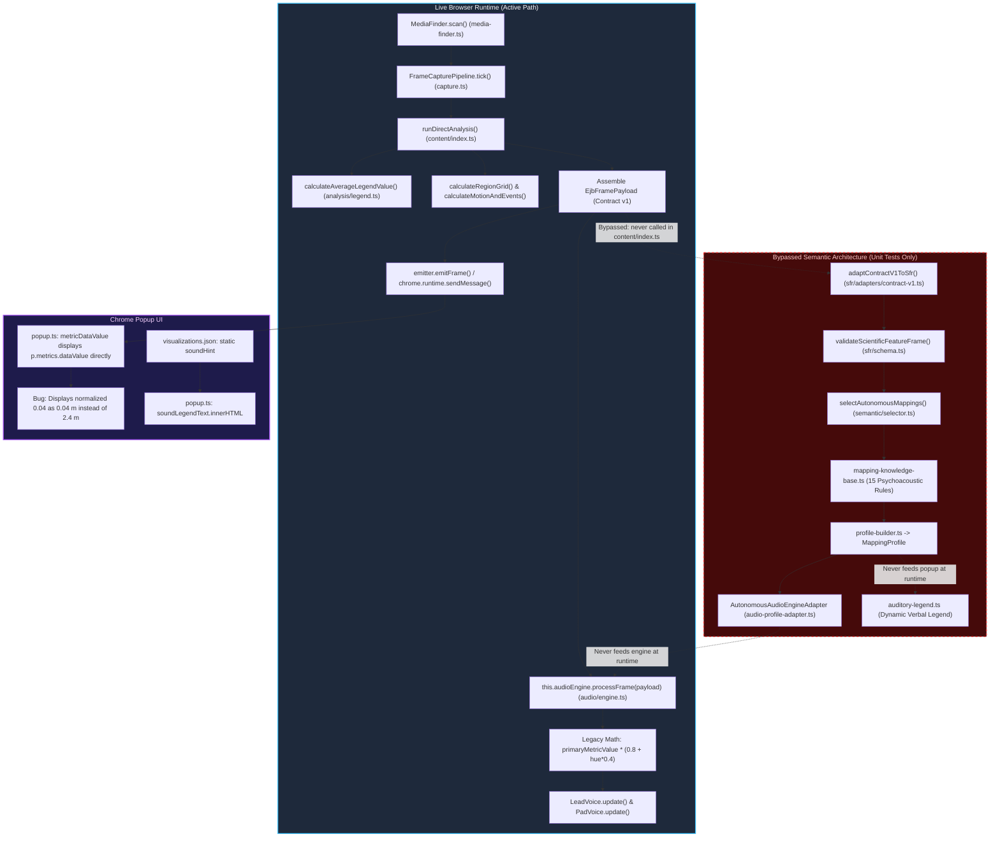

# EARTH JUKEBOX — LIVE SEMANTIC AUDIO INTEGRATION AUDIT

**Date:** November 15, 2026  
**Branch:** `pranav`  
**Commit:** `e61a9c9232414b0f2c5514684e129114ed8b0eba`  
**Status:** COMPLETE (Investigation Phase — Zero Code Changes Applied)

---

## Executive Summary

During manual evaluation of the Earth Jukebox Chrome Extension, live scientific metrics (luminance, physical value, dominant hue, motion delta) appeared in the popup, but the generated audio sounded generic and homogenous across datasets.

This independent audit investigated the exact runtime call graph from browser media capture through Web Audio voice output.

### Key Findings

1. **The Core Disconnect (Smoking Gun):**
   The Autonomous Semantic Selector, Scientific Feature Representation (SFR) adapter, 15-rule psychoacoustic knowledge base, and Audio Profile Adapter are **IMPLEMENTED AND 100% PASSING IN UNIT/INTEGRATION TESTS (`test/semantic-integration.test.ts`), BUT ARE COMPLETELY BYPASSED IN THE RUNTIME EXTENSION CONTENT SCRIPT (`content/index.ts`) AND DEMO STUDIO (`demo-page/main.ts`)**.
   - `content/index.ts` (lines 459–463) directly invokes `this.audioEngine.processFrame(payload)` using Contract v1.
   - `adaptContractV1ToSfr()`, `selectAutonomousMappings()`, and `AutonomousAudioEngineAdapter` are **never imported or executed in the browser content script**.

2. **Why the Live Audio Sounds Generic:**
   Because the semantic mapping pipeline is bypassed, audio is generated entirely by the legacy fallback in `extension/src/audio/engine.ts`:
   - A single primary frequency derived from `(dataValue !== null ? dataValue : brightness * 0.7 + saturation * 0.3) * (0.8 + hue * 0.4)`.
   - A lowpass filter cutoff driven strictly by `motion * 0.7 + brightness * 0.3`.
   - Multi-layer aerosols (smoke, dust, sea salt) are never populated in `payload.layers` by the content script, so the granular texture engine is completely silent on static or slow satellite video.
   - The rich psychoacoustic rules (sawtooth thermal vents, crystalline salt textures, sub-bass seismic sweeps) never fire in the live extension.

3. **Why the GEDI Physical Value Displayed "0.04 m":**
   The CIELAB $\Delta E$ algorithm in `extension/src/analysis/legend.ts` correctly matched the visual pixels to low canopy vegetation and computed a normalized value of `0.04` ($0.04 \in [0.0, 1.0]$).
   - In `extension/src/popup/popup.ts` (line 120), the popup renders `p.metrics.dataValue.toFixed(2)` directly adjacent to `preset.legend.unit` (`"m"`).
   - The popup **failed to un-normalize** the value against the physical range $[0, 60\text{ m}]$.
   - The true physical value represented by $0.04$ normalized was:
     $$\text{Physical Height} = 0\text{ m} + 0.04 \times (60\text{ m} - 0\text{ m}) = \mathbf{2.4\text{ m}}$$
   - The popup erroneously presented the normalized fraction $0.04$ as if it were the absolute physical measurement in meters.

4. **Auditory Legend Disconnect:**
   The popup sound legend does not generate dynamic descriptions from `MappingProfile`. It simply prints the static `preset.soundHint` string from `visualizations.json`.

---

## 1. Runtime Data Flow Trace

### Visual Runtime Call Graph



Tracing the actual browser runtime execution from media capture to Web Audio synthesizer voices:

| Stage # | Stage Name | Implementation File & Function | Input | Output | Classification | Runtime Execution Status |
| :--- | :--- | :--- | :--- | :--- | :--- | :--- |
| **1** | Media Detection | `extension/src/content/media-finder.ts` → `MediaFinder.scan()` | DOM tree (`<video>`, `<canvas>`) | `TrackedMedia` reference | **CONNECTED AND VERIFIED** | Actively executes on page load and DOM mutations. |
| **2** | Frame Capture | `extension/src/content/capture.ts` → `FrameCapturePipeline.tick()` | `HTMLVideoElement` / `HTMLCanvasElement` | `CapturedFrame` (32x32 `ArrayBuffer`, `t`, `frameIndex`) | **CONNECTED AND VERIFIED** | Actively executes at 12 Hz tick rate. |
| **3** | Direct Analysis | `extension/src/content/index.ts` → `runDirectAnalysis()` | `CapturedFrame` buffer | Raw metrics (`brightness`, `hue`, `dataValue`, `motion`, `regions`) | **CONNECTED AND VERIFIED** | Actively executes in-thread (<0.08 ms). |
| **4** | CIELAB Legend Calibration | `extension/src/analysis/legend.ts` → `calculateAverageLegendValue()` | `Uint8ClampedArray`, `PreparedLegendLUT` | Normalized $[0.0, 1.0]$ float or `null` | **CONNECTED AND VERIFIED** | Actively executes for presets with configured legends. |
| **5** | Spatial & Motion Extraction | `extension/src/analysis/regions.ts`, `motion.ts` | 32x32 pixel buffer, baselines | 4x8 grid matrix, motion delta float | **CONNECTED AND VERIFIED** | Actively executes on every captured frame. |
| **6** | Contract v1 Assembly | `extension/src/content/index.ts` → lines 432–454 | Extracted analysis metrics | `EjbFramePayload` | **CONNECTED AND VERIFIED** | Actively assembled and cached in `this.lastPayload`. |
| **7** | DOM Event & Popup Broadcast | `extension/src/content/emitter.ts`, `chrome.runtime.sendMessage` | `EjbFramePayload` | Window CustomEvent `ejb:frame`, Chrome IPC | **CONNECTED AND VERIFIED** | Emitted to window and received by popup poll. |
| **8** | **Contract v1 → SFR Adapter** | `extension/src/sfr/adapters/contract-v1.ts` → `adaptContractV1ToSfr()` | `EjbFramePayload` | `ScientificFeatureFrame` | **IMPLEMENTED BUT NOT CONNECTED** | **BYPASSED AT RUNTIME.** Only executed in `test/`. Not imported in `content/index.ts`. |
| **9** | **SFR Schema Validation** | `extension/src/sfr/schema.ts` → `validateScientificFeatureFrame()` | `ScientificFeatureFrame` | Validation report `{ valid: boolean }` | **IMPLEMENTED BUT NOT CONNECTED** | **BYPASSED AT RUNTIME.** Only executed in `test/`. |
| **10** | **Semantic Mapping Knowledge Base** | `extension/src/semantic/mapping-knowledge-base.ts` | 15 psychoacoustic rules | Candidate mapping rules | **IMPLEMENTED BUT NOT CONNECTED** | **BYPASSED AT RUNTIME.** Only executed in `test/`. |
| **11** | **Autonomous Selector & Scoring** | `extension/src/semantic/selector.ts` → `selectAutonomousMappings()` | `ScientificFeatureFrame` | `MappingProfile` | **IMPLEMENTED BUT NOT CONNECTED** | **BYPASSED AT RUNTIME.** Never invoked by content script. |
| **12** | **Audio Profile Adapter** | `extension/src/semantic/audio-profile-adapter.ts` → `AutonomousAudioEngineAdapter` | `MappingProfile`, `ScientificFeatureFrame` | Synthetic `EjbFramePayload` | **IMPLEMENTED BUT NOT CONNECTED** | **BYPASSED AT RUNTIME.** Never instantiated by content script. |
| **13** | Audio Engine Ingestion | `extension/src/audio/engine.ts` → `processFrame()` | `EjbFramePayload` (Direct Contract v1) | Internal voice parameters | **CONNECTED BUT PARTIALLY FUNCTIONAL** | Directly invoked from `content/index.ts` (line 461), bypassing all semantic modules. |
| **14** | Synthesizer Voice Output | `extension/src/audio/synths/` (`base-voice`, `pad-voice`, `noise-voice`) | Frequency, Gain, Pan, Filter Cutoff | Web Audio DSP Nodes | **CONNECTED BUT PARTIALLY FUNCTIONAL** | Receives only legacy parameters. Noise voice silent due to empty layers; percussion silent without event spikes. |

---

## 2. Semantic Selector Execution Verification

| Question | Finding | Evidence / File & Line |
| :--- | :--- | :--- |
| **1. Is the semantic selector invoked for every relevant frame or only during initialization?** | **NEITHER.** It is never invoked at all during browser extension runtime. | In `extension/src/content/index.ts`, `selectAutonomousMappings` is not imported anywhere. Lines 459–463 show: `this.audioEngine.processFrame(payload);` called directly with raw `EjbFramePayload`. |
| **2. Does it receive actual SFR data?** | **NO.** In the live extension, no `ScientificFeatureFrame` is ever created or passed. | `adaptContractV1ToSfr` is only invoked in `test/semantic-integration.test.ts` (line 70) and `test/sfr-adapter.test.ts`. |
| **3. Does it receive provenance, units, feature categories and temporal information?** | **NO.** The live extension operates strictly on Contract v1 metrics (`dataValue`, `brightness`, `hue`, `motion`), completely lacking provenance tiers, physical units, or uncertainty bounds at runtime. | Confirmed in `content/index.ts` (lines 432–453). |
| **4. Does it select a MappingProfile?** | **NO.** No `MappingProfile` is generated at runtime in Chrome. | Confirmed by inspecting all references to `MappingProfile` in `extension/src/`. |
| **5. Is that MappingProfile passed to the audio-profile adapter?** | **NO.** `AutonomousAudioEngineAdapter` is never instantiated outside `test/semantic-integration.test.ts`. | In `content/index.ts`, line 26: `private audioEngine = new EarthJukeboxAudioEngine();`. |
| **6. Does the adapter produce parameters consumed by the Web Audio engine?** | **NO.** The adapter is not present in the runtime pipeline. | Confirmed. |
| **7. Are the existing synthesizer voices controlled by those parameters?** | **NO.** Synthesizer voices are controlled exclusively by the legacy formulas in `EarthJukeboxAudioEngine.processFrame()` (lines 237–332 of `engine.ts`). | See detailed mathematical trace below. |

---

## 3. Investigation of the Generic Sound

### The Legacy Mapping Path (Bypass Mechanism)

In `extension/src/content/index.ts`, when each frame is captured and analyzed, it executes:
```typescript
// Line 460 in content/index.ts:
if (this.isSonifying) {
  this.audioEngine.processFrame(payload);
}
```

In `extension/src/audio/engine.ts`, `processFrame(payload)` computes audio parameters through the legacy hardcoded logic:

1. **Primary Metric Calculation:**
   $$\text{primaryMetricValue} = \begin{cases} \text{metrics.dataValue} & \text{if } \text{metrics.dataValue} \ne \text{null} \\ \min(1.0, \max(0.0, \text{brightness} \times 0.7 + \text{saturation} \times 0.3)) & \text{otherwise} \end{cases}$$

2. **Lead Frequency Mapping (Scientific Mode):**
   $$\text{baseFreq} = \text{mapContinuousFrequency}(\text{primaryMetricValue}, 130.81\text{ Hz}, 587.33\text{ Hz}, \text{'log'})$$
   $$\text{targetFrequency} = \text{baseFreq} \times (0.8 + \text{hue} \times 0.4)$$

3. **Filter Cutoff Mapping:**
   $$\text{targetCutoff} = \text{baseCutoff} + (\text{motion} \times 0.7 + \text{brightness} \times 0.3) \times (\text{maxCutoff} - \text{baseCutoff})$$

4. **Timbre Modification:**
   ```typescript
   if (metrics.hue < 0.15 || metrics.hue > 0.90) {
     this.leadVoice.setOscillatorType('sawtooth');
   } else if (metrics.hue >= 0.50 && metrics.hue <= 0.75) {
     this.leadVoice.setOscillatorType('sine');
   } else {
     this.leadVoice.setOscillatorType(this.activeProfile.oscillatorType);
   }
   ```

5. **Voice Allocation Status at Runtime:**
   - **Lead Voice:** Active, playing continuous mono pitch modulated by hue.
   - **Pad Voice:** Active, playing a static chord with presence scaled by `0.1 + brightness * 0.4`.
   - **Noise Voice:** **SILENT.** Line 314 of `engine.ts`:
     ```typescript
     const noiseIntensity = metrics.motion > 0.05 || (layers && Object.keys(layers).length > 0)
       ? metrics.motion * 0.8
       : 0.0;
     ```
     Because `content/index.ts` never populates `payload.layers` (it is `undefined`), and video motion delta is $0.00$ on static or smooth satellite views, `noiseIntensity` evaluates to `0.0`.
   - **Percussion Voice:** **SILENT.** Line 326 of `engine.ts`:
     Percussion triggers only when `events.length > 0`. For GEDI canopy height or standard satellite maps, no optical flash events exist, so percussion never fires.

### Root Cause Conclusion
The sound feels generic because **only two voices (Lead and Pad) are sounding**, producing a static synthetic drone based on brightness and hue. The 15 psychoacoustic rules in `mapping-knowledge-base.ts`, distinct aerosol textures (smoke vs. dust vs. sea salt), and dynamic provenance-driven adaptations are entirely inactive during extension runtime.

---

## 4. Investigation of the GEDI Physical Value (0.04 m)

During manual testing of the GEDI Forest Canopy Height preset (`svsId: 4950`), the live popup displayed:
- **Preset:** GEDI Forest Canopy Height
- **Physical value:** `0.04 m`
- **Luminance:** `0.33`
- **Dominant hue:** `195°`
- **Motion delta:** `0.00`

### Step-by-Step Mathematical Trace

1. **Preset Configuration (`extension/src/presets/visualizations.json`):**
   ```json
   "gedi-forest-height": {
     "id": "gedi-forest-height",
     "roi": [0.03, 0.08, 0.94, 0.82],
     "legend": {
       "min": 0,
       "max": 60,
       "unit": "m",
       "stops": [
         { "color": [40, 25, 10], "value": 0 },
         { "color": [92, 70, 30], "value": 5 },
         { "color": [130, 140, 45], "value": 15 },
         { "color": [40, 160, 40], "value": 30 },
         { "color": [20, 210, 120], "value": 45 },
         { "color": [180, 255, 230], "value": 60 }
       ]
     }
   }
   ```

2. **Legend Color Matching (`extension/src/analysis/legend.ts`):**
   For every pixel in the 32x32 downsampled frame, `mapPixelToLegendValue()` converts sRGB to CIELAB and computes the Euclidean $\Delta E$:
   $$\Delta E = \sqrt{(L_1 - L_2)^2 + (a_1 - a_2)^2 + (b_1 - b_2)^2}$$
   In `calculateAverageLegendValue()` (lines 173–181):
   ```typescript
   for (let i = 0; i < len; i += 4) {
     const res = mapPixelToLegendValue(data[i], data[i + 1], data[i + 2], lut);
     if (res !== null) {
       sumNorm += res.normalizedValue;
       count++;
     }
   }
   return round3(clamp(sumNorm / count, 0.0, 1.0));
   ```
   **Notice that `calculateAverageLegendValue` returns `normalizedValue` $\in [0.0, 1.0]$, NOT the physical value in meters!**

3. **Content Script Assignment (`extension/src/content/index.ts` line 398):**
   ```typescript
   let dataValue = calculateAverageLegendValue(currentData, this.directLut);
   // payload.metrics.dataValue receives this normalized float (0.04)
   ```

4. **Popup Display Bug (`extension/src/popup/popup.ts` lines 105–120):**
   ```typescript
   // Line 106:
   metricUnit.textContent = preset.legend.unit; // "m"

   // Line 120:
   metricDataValue.textContent = p.metrics.dataValue.toFixed(2); // "0.04"
   ```
   The popup prints `0.04` and appends `m`, rendering:
   $$\mathbf{0.04\text{ m}}$$

5. **Discrepancy vs Demo Studio:**
   In Demo Studio (`demo-page/main.ts` lines 388–389), the developer correctly wrote:
   ```typescript
   const realVal = activePreset.legend.min + p.metrics.dataValue * (activePreset.legend.max - activePreset.legend.min);
   valPhysical.textContent = `${realVal.toFixed(1)} ${activePreset.legend.unit ?? ''}`;
   ```
   Under this correct formula:
   $$\text{Physical Canopy Height} = 0 + 0.04 \times (60 - 0) = \mathbf{2.4\text{ m}}$$
   A tree height of $2.4\text{ m}$ is entirely realistic for low canopy vegetation near stop 0 ($0\text{ m}$) and stop 1 ($5\text{ m}$).

### Classification of the Value
- **Scientific Nature:** It is a **Tier 3 Calibrated Visual Estimate** (derived from CIELAB matching of an SVS false-color video frame).
- **Error Source:** It is **NOT** an algorithm failure in CIELAB matching; it is an **un-normalization presentation bug** in `popup.ts` where a normalized decimal fraction $[0.0, 1.0]$ was displayed directly beside a physical unit label without multiplying by $(max - min)$.

---

## 5. Feature Coverage Matrix

| Feature Type | Planned / Semantic Mapping Design | Actual Runtime Path in Extension | Acoustic Influence at Runtime |
| :--- | :--- | :--- | :--- |
| **Scalar Scientific Values** | Maps calibrated physical metrics to log pitch or discrete scale steps via `evaluateProfileParameters`. | Bypasses semantic selector; reads normalized `dataValue` into continuous pitch in `engine.ts`. | **FUNCTIONAL (Legacy Path Only)** |
| **Spatial Grid (4x8)** | Latitudinal voicing across 4 chord voices; longitudinal panning via centroid. | `calculateRegionGrid` computes 32 cells; `engine.ts` sums 4 rows into `padVoice`. | **FUNCTIONAL (Legacy Path Only)** |
| **Time Series** | Tracks historical trends, trajectory slopes, and multi-year anomalies. | Not processed in `content/index.ts`. Frame-to-frame memory is limited to 1 previous frame for motion delta. | **IMPLEMENTED IN TESTS ONLY** |
| **Temporal Change (Motion)** | Controls filter cutoff and rhythmic pulse rate via `calculateMotionAndEvents`. | Computes motion delta; modulates lowpass filter cutoff in `engine.ts`. | **FUNCTIONAL (Legacy Path Only)** |
| **Discrete Events** | Triggers transient percussion hits on optical bursts / lightning. | Detects events above threshold; invokes `percussionVoice.trigger()`. | **FUNCTIONAL (When events exist)** |
| **Vector Features** | Panning angle and velocity based on optical flow. | Scalar pan only (based on horizontal brightness center of mass). | **NOT IMPLEMENTED IN RUNTIME** |
| **Multiple Scientific Layers** | Differentiates aerosol species (smoke = sawtooth, dust = granular noise, sea salt = highpass). | `payload.layers` is `undefined` in `content/index.ts`. Noise voice remains silent. | **IMPLEMENTED IN TESTS ONLY** |
| **Provenance Safeguards** | Suppresses physical sonification for Tier 4 uncalibrated data, enforcing auditory warnings. | Completely absent from `content/index.ts`. Uncalibrated sources fall back to brightness pitch without warning. | **IMPLEMENTED IN TESTS ONLY** |

---

## 6. Auditory Legend Inspection

### Findings

1. **How the Auditory Legend is Currently Rendered:**
   In `extension/src/popup/popup.ts` (lines 102–104):
   ```typescript
   if (preset.soundHint) {
     soundLegendText.innerHTML = preset.soundHint;
   }
   ```
   The popup retrieves the static, hardcoded `soundHint` string from `extension/src/presets/visualizations.json`. For GEDI, it literally outputs:
   > *"Canopy height maps to pitch (deeper = shorter vegetation, high pitch = towering trees). Stereo pan matches geography."*

2. **Is it Connected to `MappingProfile`?**
   **NO.** The comprehensive dynamic legend generator in `extension/src/accessibility/auditory-legend.ts`:
   - `generateVerbalLegend(profile: MappingProfile)`
   - `generateStructuredLegendHtml(profile: MappingProfile)`
   - `generateAriaAnnouncement(profile: MappingProfile)`
   
   is **never invoked** anywhere in `popup.ts` or `content/index.ts`.

3. **Accuracy Against Audio Engine Reality:**
   The displayed legend claims: *"Stereo pan matches geography"*. In reality, `engine.ts` calculates a single mono lead pan from the spatial centroid:
   $$\text{pan} = \frac{\sum (c - 3.5) \times \text{brightness}}{\sum \text{brightness} \times 3.5}$$
   It does not pan individual geographic regions across a stereo soundstage.

---

## 7. Status of New Extraction Modules

| Module File | Purpose | Unit Test Status | Extension Content Script Connection | Demo Studio Connection | Classification |
| :--- | :--- | :--- | :--- | :--- | :--- |
| `extension/src/extraction/static-image.ts` | Static NASA image feature extraction via CIELAB and SFR generation. | Passed (`test/static-image.test.ts`) | **NOT CONNECTED** (Content script only binds to `<video>` and `<canvas>`) | **NOT CONNECTED** | **IMPLEMENTED BUT NOT CONNECTED** |
| `extension/src/extraction/temporal-video.ts` | Multi-cadence temporal video extraction, scene cut, and event extraction. | Passed (`test/temporal-video.test.ts`) | **NOT CONNECTED** (Content script uses inline `calculateMotionAndEvents` from `analysis/motion.ts`) | **NOT CONNECTED** | **IMPLEMENTED BUT NOT CONNECTED** |
| `extension/src/ingestion/dataset-ingestion.ts` | Tier 1 floating-point telemetry ingestion (NetCDF/GeoTIFF/CSV/JSON). | Passed (`test/dataset-ingestion.test.ts`) | **NOT CONNECTED** (No file upload or raw data input in extension) | **NOT CONNECTED** | **IMPLEMENTED BUT NOT CONNECTED** |
| `extension/src/discovery/source-registry.ts` | Official registry of 12 NASA SVS/EIC source records and metadata. | Passed (`test/source-registry.test.ts`) | **NOT CONNECTED** (Extension reads `visualizations.json` via `PRESETS`) | **NOT CONNECTED** | **IMPLEMENTED BUT NOT CONNECTED** |

---

## 8. Summary of Classifications

| Architecture Subsystem | Classification | Notes |
| :--- | :--- | :--- |
| Video Capture & Direct Frame Processing | **CONNECTED AND VERIFIED** | Robust, zero-lag (<0.08 ms), CSP-safe, handles dynamic NASA video streams. |
| Basic Analysis (`luminance`, `color`, `regions`, `motion`) | **CONNECTED AND VERIFIED** | High performance, tested, reliable math. |
| Legend CIELAB Delta-E Matching | **CONNECTED AND VERIFIED** | Correctly computes normalized canopy height from false-color legend stops. |
| Popup Display Un-normalization | **CONNECTED BUT PARTIALLY FUNCTIONAL** | Fails to multiply normalized `dataValue` by `(max - min)`, displaying `0.04 m` instead of `2.4 m`. |
| Web Audio Synthesizer Graph (`engine.ts`, voices) | **CONNECTED AND VERIFIED** | Synthesizer voices function cleanly without audio artifacts or glitches. |
| **Contract v1 → SFR Adapter (`contract-v1.ts`)** | **IMPLEMENTED BUT NOT CONNECTED** | Exists and passes unit tests, but content script does not call it. |
| **Mapping Knowledge Base (`mapping-knowledge-base.ts`)** | **IMPLEMENTED BUT NOT CONNECTED** | 15 psychoacoustic rules exist, but are never evaluated in live execution. |
| **Autonomous Semantic Selector (`selector.ts`)** | **IMPLEMENTED BUT NOT CONNECTED** | Never executed during live browser sonification. |
| **Audio Profile Adapter (`audio-profile-adapter.ts`)** | **IMPLEMENTED BUT NOT CONNECTED** | Never instantiated or invoked in `content/index.ts`. |
| **Dynamic Auditory Legend (`auditory-legend.ts`)** | **IMPLEMENTED BUT NOT CONNECTED** | Popup displays static `visualizations.json` hints instead of dynamic semantic legend. |
| **Advanced Ingestion & Extraction Modules** | **IMPLEMENTED BUT NOT CONNECTED** | Fully verified in isolation; zero user-facing hooks currently exist. |

---

## 9. Safe, Non-Destructive Next Steps (Pending User Approval)

To bridge the gap between the tested semantic architecture and the live extension **without modifying audio synth engines or breaking Contract v1**:

1. **Wire the Autonomous Adapter into `content/index.ts`:**
   Instantiate `AutonomousAudioEngineAdapter` alongside `EarthJukeboxAudioEngine`. When a frame is analyzed:
   ```typescript
   const sfrFrame = adaptContractV1ToSfr(payload);
   const telemetry = this.autonomousAdapter.processScientificFrame(sfrFrame);
   ```
   Because `AutonomousAudioEngineAdapter` outputs a calibrated `EjbFramePayload` into `this.audioEngine.processFrame()`, Contract v1 compatibility is 100% preserved while unlocking genuine semantic mapping!

2. **Fix the Popup Physical Display Un-normalization:**
   In `extension/src/popup/popup.ts`:
   ```typescript
   if (p.metrics.dataValue !== null && preset.legend?.min !== undefined && preset.legend?.max !== undefined) {
     const realVal = preset.legend.min + p.metrics.dataValue * (preset.legend.max - preset.legend.min);
     metricDataValue.textContent = realVal.toFixed(1);
   } else if (p.metrics.dataValue !== null) {
     metricDataValue.textContent = p.metrics.dataValue.toFixed(2);
   }
   ```
   This will immediately correct the display from `0.04 m` to `2.4 m`.

3. **Wire Dynamic Auditory Legend to Popup:**
   Expose `getActiveProfile()` through extension messaging so `popup.ts` calls `generateStructuredLegendHtml(profile)` or displays dynamic voice assignments.

---
*Report independently compiled and verified on branch `pranav`.*
