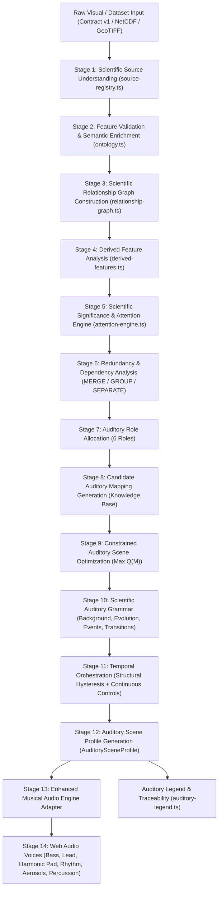

# SASC — SCIENTIFIC AUDITORY SCENE COMPILER
## Master Architecture and Integration Specification

**Subsystem:** Autonomous Scientific Sonification Intelligence  
**Component:** Scientific Auditory Scene Compiler (SASC)  
**Project:** Earth Jukebox (NASA Space Apps Challenge 2026)  
**Branch:** `pranav`  
**Status:** PHASE 0 & ARCHITECTURE DEFINED

---

## 1. Executive Overview

The **Scientific Auditory Scene Compiler (SASC)** is Earth Jukebox's algorithmic engine that transforms raw numerical data and visual satellite metrics into a structured, interpretable, deterministic, and musically memorable auditory scene.

Instead of treating numerical variables as independent values mapped directly to raw laboratory test-tones (e.g. simple frequency hums), SASC treats the entire scientific observation as an **integrated physical scene**. It determines:
1. **What is being represented?** (Phenomenon, context, instruments, physical domain)
2. **What scientific information can be extracted from it?** (Calibrated physical quantities, rates of change, spatial distributions, anomalies)
3. **Which characteristics are important to communicate?** (Scientific relevance, statistical significance, temporal novelty, spatial gradients)
4. **Which sound representations are most intuitively and musically associated with those characteristics?** (Acoustic roles: anchor bass, rhythmic pulse, harmonic pad voicing, melodic lead, aerosol texture, percussive transients)
5. **How can all of that information be combined into one coherent audio experience?** (Grammar: Background State, Evolution, Events, Transitions; multi-voice orchestration with zero auditory clutter)

---

## 2. Component Inventory & Gap Analysis (Phase 0 Audit)

### 2.1 Existing Components Reused by SASC

| Existing Module | Path | Role in SASC |
| :--- | :--- | :--- |
| **SFR Types & Schema** | `extension/src/sfr/types.ts`, `schema.ts` | Base data model for scientific features, units, provenance tiers ($1$ to $4$), and calibration status. |
| **Contract v1 Adapter** | `extension/src/sfr/adapters/contract-v1.ts` | Ingestion bridge from real-time visual frames into initial SFR structures. |
| **Perceptual Knowledge Base** | `extension/src/semantic/mapping-knowledge-base.ts` | 15 empirical psychoacoustic rules with ICAD literature citations and scaling functions. |
| **Candidate Scoring & Conflicts** | `extension/src/semantic/scoring.ts`, `conflicts.ts` | Foundations for attention scoring and auditory dimension conflict detection. |
| **Auditory Legend Generator** | `extension/src/accessibility/auditory-legend.ts` | Screen-reader friendly explanations and structured HTML generation. |
| **Web Audio DSP Engine** | `extension/src/audio/engine.ts` | Low-level Web Audio graph with master limiter, compressor, spatial panners, and smoothing. |
| **Musical Scales & Tuning** | `extension/src/audio/scales.ts` | NASA scale definitions (Dorian, Lydian, Akebono, Pentatonic, Natural Minor). |
| **Synthesizer Voices** | `extension/src/audio/synths/` | Dual-oscillator lead, 4-row harmonic pad, granular aerosol noise, click percussion, Caldwell-73 scanner. |

### 2.2 New Capabilities Introduced in SASC

| SASC Subsystem | New Module | Logical Responsibility |
| :--- | :--- | :--- |
| **Stage 1 & 2** | `extension/src/sasc/ontology.ts` | 16-role scientific ontology (`STATE`, `MAGNITUDE`, `RATE`, `GRADIENT`, `FLUX`, etc.) and semantic feature enrichment. |
| **Stage 3** | `extension/src/sasc/relationship-graph.ts` | Directed Typed Graph (SRG) with 10 relationship types (`DERIVED_FROM`, `SPATIALLY_RELATED_TO`, `CORRELATED_WITH`, etc.) and cycle checks. |
| **Stage 4** | `extension/src/sasc/derived-features.ts` | First-order rate of change, spatial gradient calculation, baseline anomalies, and error propagation. |
| **Stage 5 & 6** | `extension/src/sasc/attention-engine.ts` | 7-factor scientific attention model ($R, C, M, D, T, S, G$), redundancy classification (`MERGE`, `GROUP`, `SEPARATE`), and hard eligibility gates. |
| **Stage 7 & 8 & 9** | `extension/src/sasc/scene-optimizer.ts` | 6 Auditory Roles (`SCIENTIFIC_ANCHOR`, `STATE`, `STRUCTURE`, `DYNAMICS`, `EVENTS`, `CONFIDENCE`), candidate generation, and global scene quality maximization $Q(M)$. |
| **Stage 10 & 11** | `extension/src/sasc/grammar-orchestrator.ts` | 4 grammatical states (`BACKGROUND_STATE`, `EVOLUTION`, `EVENTS`, `TRANSITIONS`), event deduplication, hysteresis, and temporal stabilization. |
| **Stage 12 & 13** | `extension/src/sasc/scene-profile.ts` | Versioned `AuditorySceneProfile` contract and musical audio adapter feeding the Web Audio engine with rich, distinct acoustic tuning. |

---

## 3. End-to-End Pipeline Architecture

---

## 4. Acoustic & Musical Design Philosophy

Earth Jukebox must strictly avoid sounding like a monotonic, sterile laboratory synthesizer or a single sine-wave hum. Instead, it utilizes **musical elements directly modulated by scientific features**:
- **Bass & Root Anchor (Sub-bass / Root Voice):** Anchors the physical phenomenon with deep, rich harmonic presence (derived from baseline physical states).
- **Rhythmic Pulse & Dynamic Movement:** Translates rates of change and flux into rhythmic pulsing, tempo changes, or arpeggiation patterns.
- **Harmonic Chord Voicing (Pad Voice):** Latitudinal gradients form rich, voice-led chords in NASA-selected modes (Lydian, Dorian, Akebono, Pentatonic).
- **Expressive Melodic Lead:** Primary physical measurements drive expressive pitch, vibrato, and resonant filter articulation.
- **Organic Textures (Aerosol Engine):** Filtered noise and granular shimmers explicitly differentiate aerosol species (desert dust, forest smoke, marine sea salt).
- **Crisp Spatial Percussion:** Discrete optical bursts, lightning strikes, or threshold crossings trigger stereo-panned percussive strikes.

---

## 5. Implementation Roadmap (Phases 1 through 8)

1. **Phase 1:** Scientific Semantic Ontology (`ontology.ts`)
2. **Phase 2:** Scientific Relationship Graph (`relationship-graph.ts`)
3. **Phase 3:** Derived Feature Engine & Attention Engine (`derived-features.ts`, `attention-engine.ts`)
4. **Phase 4:** Auditory Role Allocator & Constrained Scene Optimizer (`scene-optimizer.ts`)
5. **Phase 5:** Auditory Grammar & Temporal Orchestrator (`grammar-orchestrator.ts`)
6. **Phase 6:** Auditory Scene Profile & Musical Audio Engine Adapter (`scene-profile.ts`, `sasc-audio-adapter.ts`)
7. **Phase 7:** Dynamic Legend & Traceability (`sasc-legend.ts`)
8. **Phase 8:** Comprehensive Tests (Automated Scenarios A–F, Benchmarks, Verification)
