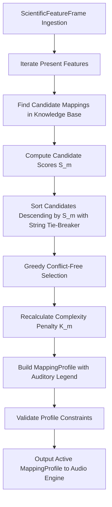

# Earth Jukebox (EJB) — Autonomous Semantic Sonification Engine

> **Document Type:** System Architecture & Algorithmic Specification  
> **Authors:** Pranav K & Ujwal A (NASA Space Apps Challenge 2026)  
> **Source Module:** `extension/src/semantic/`

---

## 1. Executive Summary

The **Autonomous Semantic Sonification Engine** bridges Earth Science datasets and the Web Audio synthesis layer. In place of static, hardcoded audio presets, the engine autonomously analyzes incoming scientific feature representations (`ScientificFeatureFrame`), consults an evidence-backed knowledge base of psychoacoustic rules, evaluates candidate mappings through a multi-factor fitness function, resolves parameter collisions, and synthesizes a conflict-free `MappingProfile` complete with verbal auditory legends.

The engine executes in **under 1 millisecond** per evaluation cycle, enabling real-time autonomous adaptation as video streams, satellite passes, or user-selected layers change.

---

## 2. Core Mathematical Algorithm: Candidate Scoring Function

For any pair of scientific feature $F_i$ and candidate knowledge base mapping $M_j$, the fitness score $S(m)$ is computed via a weighted linear combination with a cognitive complexity penalty:

$$S(m) = w_1 P(m) + w_2 C(m) + w_3 D(m) + w_4 I(m) - w_5 K(m)$$

Subject to $\sum_{k=1}^4 w_k - w_5 \approx 0.90 \dots 1.00$, clamped to $S(m) \in [0.0, 1.0]$.

### 2.1. Parameter Breakdown

| Component | Symbol | Range | Description & Weight ($w_k$) |
|---|---|---|---|
| **Data Provenance** | $P(m)$ | $[0.40, 1.0]$ | **$w_1 = 0.35$**: Reflects data reliability. Tier 1 (physical SI instrument) = 1.0; Tier 2 (reanalysis) = 0.85; Tier 3 (calibrated colorbar) = 0.70; Tier 4 (visual pixel proxy) = 0.45. |
| **Literature Confidence** | $C(m)$ | $[0.50, 1.0]$ | **$w_2 = 0.25$**: Psychophysical empirical strength. `strong_empirical` (Spence, Stevens, Bregman) = 1.0; `moderate_literature` (ICAD/NASA SVS) = 0.75; `design_hypothesis` = 0.50. |
| **Crossmodal Distinction** | $D(m)$ | $[0.75, 1.0]$ | **$w_3 = 0.20$**: Dimensional naturalness. Discrete event to percussive trigger = 1.0; vertical height to pitch = 1.0; motion to filter cutoff = 1.0; generic = 0.75. |
| **Informational Salience** | $I(m)$ | $[0.50, 1.0]$ | **$w_4 = 0.15$**: Dynamic presence. Non-zero, active variance, calibrated status = 1.0; static or zero = 0.5. |
| **Cognitive Complexity Penalty** | $K(m)$ | $[0.0, 1.0]$ | **$w_5 = 0.05$**: Penalizes overcrowding. Escalates if target synthesizer voice or parameter is already carrying active modulations. |

---

## 3. Conflict Detection & Channel Collision Matrix

To ensure auditory clarity and prevent masking, the selector enforces rigid physical and perceptual exclusivity:

1. **Monophonic Lead Parameter Exclusivity:**
   - Only one scientific feature may control `pitch_frequency` on `lead_voice` simultaneously.
   - If both `canopy_height` and `sea_surface_temperature` are present, the higher-scoring feature (typically Tier 1 physical canopy height over Tier 3/4 proxies) wins the pitch channel.
2. **Filter Cutoff Exclusivity:**
   - Only one feature may modulate `lowpass_cutoff` per frame.
3. **Auditory Scene Analysis (ASA) Stream Limit:**
   - Bregman's ASA guidelines state humans can track at most 3 to 4 independent auditory streams. Earth Jukebox hard-caps the active voice count at **4 concurrent voices** (`lead_voice`, `pad_voice`, `percussion_voice`, `noise_voice`).
4. **Voice Polyphony Cap:**
   - No individual synthesizer voice may receive more than 3 concurrent parameter modulations.

---

## 4. Deterministic Tie-Breaking & Execution Flow

Tie-breaking is strictly deterministic: if two candidate mappings produce identical scores ($\Delta S < 10^{-4}$), their alphabetical `mappingId` strings are compared. This guarantees that given identical input data, the engine generates byte-for-byte identical sonification configurations.

---

## 5. Computational Complexity Analysis

- Let $N$ be the number of active features in the frame ($N \le 10$ in practical NASA presets).
- Let $M$ be the maximum candidates matched per feature ($M \le 3$).
- Let $K = N \cdot M$ be the total candidate mappings pool ($K \le 30$).
- Scoring step: $O(K)$.
- Sorting step: $O(K \log K)$.
- Greedy conflict check: $O(K \cdot A)$ where $A \le 4$ active assignments.
- Overall complexity: $\mathcal{O}(K \log K)$, which on standard V8 JavaScript engines executes in **$< 0.2\text{ ms}$**, well under the $5\text{ ms}$ budget and well inside the 60 FPS ($16.6\text{ ms}$) video render cycle.

---

## 6. Amendment A Extensions (Distinct-by-Construction Scoring & Hysteresis)

Under Amendment A, Section A7, candidate scoring is value-aware and incorporates explicit feature salience, diversity bonus, and hysteresis:

### 6.1. Scoring Formula
$$S(m) = w_1 P(m) + w_2 C(m) + w_3 D(m) + w_4 I(m) + w_6 \text{Sal}(m) + w_7 \text{Div}(m) - w_5 K(m)$$

### 6.2. Weight Distribution
- $w_1 = 0.20$ (Data Provenance tier)
- $w_2 = 0.20$ (Literature Confidence)
- $w_3 = 0.20$ (Crossmodal Directness)
- $w_4 = 0.15$ (Information content & variance)
- $w_6 = 0.20$ (Dynamic Value-Aware Salience)
- $w_7 = 0.05$ (Stream Diversity Bonus)
- $w_5 = 0.25$ (Auditory Masking & Complexity Penalty)

### 6.3. Value-Aware Salience Ranking
Salience is computed from reference-relative z-scores ($z_f = (f - \mu)/\sigma$), feature confidence, and novelty:
$$\text{salience}_f = \text{importance}_f \times |z_f| \times \text{confidence}_f \times (1 + \text{novelty}_f)$$

The top 3 salient features are allocated as **Foreground** roles:
1. `foreground_1`: Lead voice (pitch modulation)
2. `foreground_2`: Rhythm voice (pulse tempo, pattern)
3. `foreground_3`: Tension/texture voice (filter cutoff, resonance, noise)

### 6.4. Hysteresis Stability (Section A8)
To prevent erratic timbral flipping during continuous video playback:
- Mapping profiles rebuild on **source load** or on **scene cuts**.
- During steady playback, candidate evaluation occurs at most once every **12 seconds**.
- Profile updates require **2 consecutive evaluations** with altered foreground role ranking before switching.

